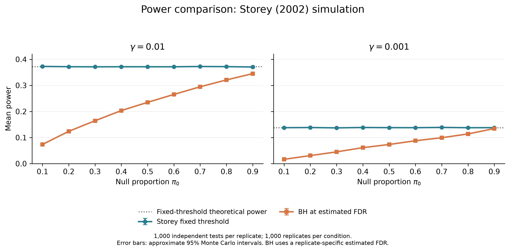
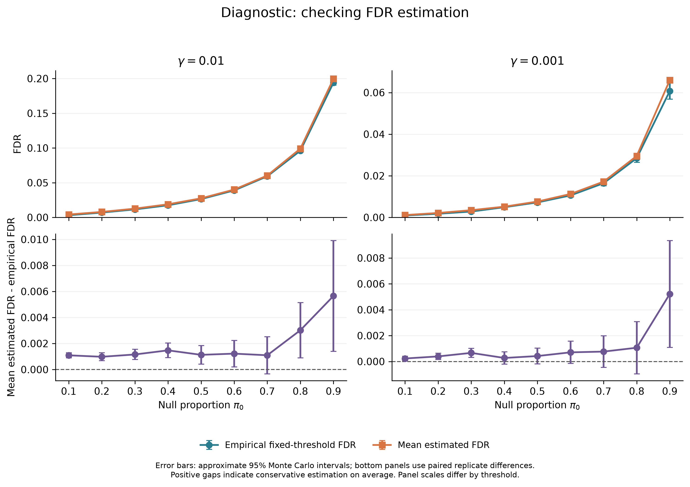

# Simulation Study: Storey's FDR Approach

Author: Linxuan Ma  
Course: STATS 607 — Unit 2 Project

## Overview

This project reproduces the simulation in Section 5 of Storey (2002), focusing on Table 2 and the power comparison in Figure 1.

It compares a fixed p-value threshold with the Benjamini–Hochberg (BH) procedure. Following the paper, BH uses the FDR level estimated by the fixed-threshold procedure in each replication.

The simulation includes 18 conditions:
- 1,000 hypotheses per replication
- Null proportions from 0.1 to 0.9
- Fixed thresholds of 0.01 and 0.001
- 1,000 replications per condition
- Independent normal test statistics with alternative mean 2

The bootstrap tuning procedure discussed later in the paper is outside the scope of this project.

## Setup

The project was tested with Python 3.13.2 on macOS.
The commands below require Python 3 and Make.

From the project folder, create and activate a virtual environment:

```bash
python3 -m venv .venv
source .venv/bin/activate
python3 -m pip install -r requirements.txt
```

## Run the project

Generate simulation results, summary tables, and figures:

```bash
make all
```

Run the tests:

```bash
make test
```

The simulation took about 2.3 seconds on the development machine. Total runtime also includes analysis and figure generation and will vary across machines.

Available commands:

| Command | Action |
|---------|--------|
| `make all` | Run the simulation, analysis, and figure generation |
| `make simulate` | Generate replication-level results |
| `make analyze` | Run the simulation and summarize results |
| `make figures` | Run the simulation, analysis, and figure generation |
| `make test` | Run the test suite |
| `make clean` | Remove generated results and figures |

The Makefile reruns earlier pipeline stages when needed by a target.
For example, `make analyze` also reruns the simulation.

## Project files

| File | Purpose |
|------|---------|
| `ADEMP.md` | Simulation design and full condition table |
| `ANALYSIS.md` | Findings, reproduction differences, and limitations |
| `src/dgps.py` | Data generation and theoretical power |
| `src/methods.py` | Fixed-threshold and BH procedures |
| `src/metrics.py` | False discovery proportion and power |
| `src/simulation.py` | Simulation configuration and main loop |
| `src/analyze.py` | Summaries and comparison with published values |
| `src/figures.py` | Power comparison and FDR diagnostic plots |
| `tests/test_simulation.py` | Tests of methods, metrics, and reproducibility |
| `requirements.txt` | Python dependencies |

## Outputs

- `results/raw/replicates.csv`: results for all 18,000 replications
- `results/raw/run_info.json`: configuration and runtime information
- `results/summary.csv`: means and Monte Carlo standard errors
- `results/paper_comparison.csv`: comparisons with Table 2
- `results/figures/`: two figures, each saved as PNG and PDF

The configuration is defined in `src/simulation.py`.
The master seed is `20261011`, with a separate random stream for each condition. Replication-level results are retained so that summaries can be checked.

## Main findings

The fixed-threshold procedure has higher average power than BH under the paper's comparison rule. Its power is close to the theoretical values of 0.372 and 0.138 for the two thresholds.

Most results are close to Table 2. One unresolved difference occurs at gamma = 0.001 and pi0 = 0.8: reproduced BH power is 0.11379, while the paper reports 0.129. See `ANALYSIS.md` for the uncertainty calculation and discussion.

### Power comparison



### FDR diagnostic



Error bars show approximate 95% Monte Carlo intervals.

## Validation

Nine tests check data generation, theoretical power, rejection decisions, FDR estimation, performance metrics, and reproducibility.

## Reference

Storey, J. D. (2002). A direct approach to false discovery rates. *Journal of the Royal Statistical Society: Series B (Statistical Methodology)*, 64(3), 479–498.